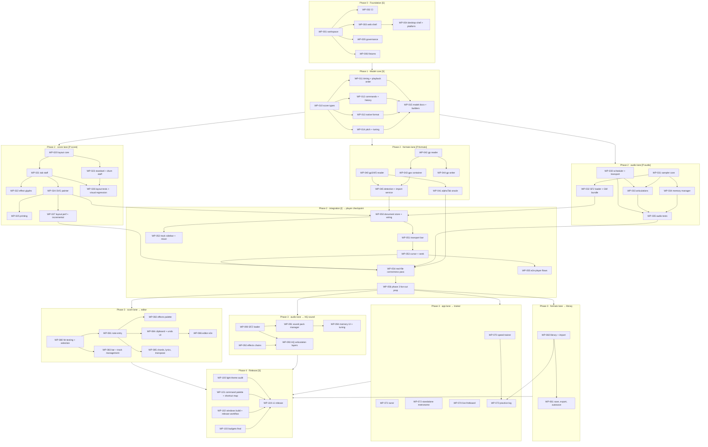

# Roadmap

The build order for Reprise v1, with every piece of work marked as sequential or parallel. Each phase has its own plan file with the work packages in detail; every work package becomes one GitHub issue.

## Legend

| Marker        | Meaning                                                                                                                     |
| ------------- | --------------------------------------------------------------------------------------------------------------------------- |
| `[S]`         | **Sequential.** Done by the lead, blocks everything after it. Nothing else runs while this is open unless marked otherwise. |
| `[P:score]`   | **Parallel, score lane.** Owns `packages/layout` and `apps/web/src/features/score` (later `features/editor`).               |
| `[P:audio]`   | **Parallel, audio lane.** Owns `packages/audio` (later `apps/web/src/features/sounds`).                                      |
| `[P:formats]` | **Parallel, formats lane.** Owns `packages/formats` (later `apps/web/src/features/library`).                                 |
| `[P:app]`     | **Parallel, app lane.** Owns `apps/web/src/features/trainer`. Exists only from phase 3.                                      |
| `[I]`         | **Integration.** Done by the lead, wires lane output into `apps/web`. Starts when the lane work it names is merged.          |

Sizes are by scope, never time: **S** a focused change in one file or module; **M** a module with tests; **L** a subsystem with several modules and a test suite; **XL** should have been split, and is only used when splitting would create artificial seams.

## Phases

```
Phase 0  Foundation                    [S]
Phase 1  Model core                    [S]
Phase 2  Three lanes -> Player         [P:score] [P:audio] [P:formats]  then  [I] player checkpoint
Phase 3  Four lanes -> Full feature    [P:formats] [P:app] [P:score] [P:audio]  then  [I] per checkpoint
Phase 4  Release                       [S]
```

| Phase | Plan file                          | Mode     | Exit condition                                                                                                           |
| ----- | ---------------------------------- | -------- | ------------------------------------------------------------------------------------------------------------------------ |
| 0     | `phase-0-foundation.md`            | serial   | Workspace, CI, web and desktop shells, governance and fixtures exist. A deliberate boundary violation fails lint.         |
| 1     | `phase-1-model-core.md`            | serial   | The contracts in `../specs/architecture.md` are implemented in `@reprise/model` with tests. Contracts are frozen.        |
| 2     | `phase-2-lanes-to-player.md`       | parallel | **Player checkpoint**: open a downloaded gp5, read it, play it with correct repeats, loop, slow down, mix, print.         |
| 3     | `phase-3-lanes-to-full-feature.md` | parallel | **Library, trainer, editor and HQ sound checkpoints**, each integrated as its lane finishes.                              |
| 4     | `phase-4-release.md`               | serial   | v1 tagged, macOS and Windows installers on a GitHub Release, light theme audited, shortcut map complete.                  |

## Dependency graph

Work-package level. Arrows mean "must be merged before". Lanes are columns; the lead's serial and integration work are the top and bottom rows.



## Checkpoints and their definition of done

- **Player checkpoint** (end of phase 2). Tomer can drag a gp3, gp4, gp5, gp or gpx file onto the app, read it as tab with rhythm stems, hear it through the GM tier with repeats, alternate endings and jumps played correctly, slow it to 50% BPM-accurate, loop four bars, mute the guitar track to play along, and print it. Performance budgets hold on the benchmark score.
- **Library checkpoint**. Imported songs appear in a library with search and sort; a song reopens from the library with its settings; save, save-as and export-to-gp work with a lossy warning; the editor's drafts survive a crash.
- **Trainer checkpoint**. Speed trainer ramps a loop; the tuner shows cents for an open string through the mic; the standalone metronome runs without a song; the practice log shows time and tempos per song; the live fretboard follows playback.
- **Editor checkpoint**. A new song can be written from scratch with the keyboard only, saved as native and exported as gp, with every effect in scope applied and heard, with undo across all of it.
- **HQ sound checkpoint**. A downloaded SFZ guitar pack plays a track with palm mutes and harmonics on their own layers through a distortion preset; memory stays under budget with four HQ tracks loaded; switching songs evicts.
- **Release**. v1 tag, installers for macOS and Windows attached to a GitHub Release, the light theme audited screen by screen, the shortcut reference complete.

## Budgets

Measured on the reference "long score": 8 tracks, 300 bars, in mixed notation: track i shows tab, standard notation or both, in turn (`i % 3`).

| Metric                                      | Budget | Asserted by                                          |
| ------------------------------------------- | ------ | ---------------------------------------------------- |
| Full layout, cold                           | 250 ms | `packages/layout/src/layout.bench.ts`                |
| Re-layout after a single-note edit          | 16 ms  | `packages/layout/src/layout.bench.ts`                |
| Re-layout after a rhythm edit, continuous   | 16 ms  | `packages/layout/src/layout.bench.ts`                |
| Mounted SVG elements at any zoom            | 20 000 | `apps/web/src/features/score/budget.test.ts`         |
| Decoded audio resident, GM tier, any song   | 80 MB  | `packages/audio/src/samples/memory-budget.test.ts`   |
| Decoded audio resident, HQ tier, default    | 300 MB | WP-094                                               |
| Renderer heap after opening the long score  | 400 MB | `apps/web/e2e/player/budgets.spec.ts`                |
| Time from file drop to first paint          | 500 ms | `apps/web/e2e/player/budgets.spec.ts`                |

Measured by `pnpm bench`: the `*.bench.ts` files run one at a time after three warm-up iterations, never inside the parallel `pnpm test`, and CI runs them as their own step after the tests. A time budget holds on the reference machine, an Apple M4 Pro (14 cores) on Node 24, and is multiplied by 3.4 on CI, a GitHub-hosted `ubuntu-latest` runner (4 vCPU x64), whose pool mixes CPU models. The two CI runs of #90 measured the cold-layout bench at 2.95 times the reference machine on an AMD EPYC 7763 (199 ms against 67.5 ms) and 2.40 times on an AMD EPYC 9V74 (162 ms); 3.4 is the larger ratio with 15% to spare. The factor changes only in a PR of its own that changes no measured code and cites at least five CI Bench runs on `main` against three local runs: the largest CI-to-local ratio with 15% to spare, rounded up to one decimal, which may lower the factor as well as raise it. A PR whose own bench fails on CI fixes the code or the budget row, never the factor. The Bench step checks ceilings only: a regression fails it once it pushes a measurement past its threshold, so a 2× slowdown under a budget with more headroom passes; The `bench-compare` job is the other check (#98). On pull requests it benches the budgeted `ms` rows of the PR's merge commit and of `main` (its first parent) on one runner, five alternating rounds, and fails a row whose paired median ratio is above ×1.20 and whose paired median delta is above a per-row floor, 5% of the row's threshold unless the row overrides it in `FLOOR_SHARES` in `scripts/bench/compare.ts` (42.5 ms for cold layout and 2.7 ms for re-layout on CI; every row takes the default floor, `FLOOR_SHARES` is empty, and the ten-PR trial before the job becomes required restarts from #146). The tolerance is fixed at ×1.20, not derived: ten unchanged CI runs of the job measured paired median ratios of 0.92 to 1.04 for cold layout and 0.83 to 1.14 for re-layout (the 1.14 was +1.1 ms, under the floor), while a 1.3× slowdown measures 1.29 to 1.32. It changes only in a PR of its own that changes no measured code and cites unchanged CI runs; a false failure on one row raises that row's floor, not the ratio. A deliberate slowdown, or a PR that changes what a compared row measures, takes the lead's `bench:accept-slower` label and a re-run of the job, and says why in the PR body. The label stays on the PR until it is removed, so every later push is accepted while it is there; the job prints a warning for each accepted row. A `main` that produces no report fails the job. The two renderer rows and the unbudgeted measurements are not compared. The job ran for 2.4 to 4.3 minutes over ten unchanged CI runs before #146 and 2.3 to 4.0 minutes (the benching step) over the ten proof runs after it, on a runner beside `ci` and `e2e`; a PR touching no path the rows depend on skips the benching and reports success in seconds (an estimate, not yet measured on CI). It is not a required check yet: it becomes one once it has run on ten PRs with no false failure. Byte and element budgets are deterministic and never scaled. A `.test.ts` in the last column asserts its budget in the unit suite; a work package there has not measured it yet. The re-layout row is the slowest p50 of eight single-note-edit benches: mixed, tab, standard and both notation, each paged and continuous. A continuous edit that changes a bar's width moves every later segment without re-rendering it (#101); it is measured as "Re-layout after a rhythm edit, continuous", against the same 16 ms, as the median of the edits that keep the segment breaks (about half of the 31 timed rhythm edits, each timed alone; #146). The edits that move a segment break re-render until the breaks realign and are measured as "Re-layout after a segment-break-moving edit, continuous", with no budget: about 3 ms against about 23 ms locally. Taking the median over the whole mix flipped between the two groups, so the row jumped 2× on unchanged code. Ten unchanged CI runs of the job on a stacked proof PR kept the row's paired median ratio within 0.98 to 1.02 (runs 42519334029, attempts 1 to 10, on EPYC 7763, 9V74 and 9V45), and a deliberate 1.5× slowdown of continuous re-layout failed it at 1.57× (+3.1 ms, run 42522997880). A paged edit that moves a page break re-renders every later system; it is measured as "Re-layout after a page-break-moving edit, paged" and has no budget.

The two renderer rows are measured by `pnpm e2e` instead, in `apps/web/e2e/player/budgets.spec.ts`. That is the production build in headless Chromium, with the long score generated as a `.reprise` file whose track *i* shows tab, standard or both notation, dropped on a freshly loaded page. Drop to paint is the median of three pages, from the `drop` event to the first animation frame after a system mounts with fonts ready. The heap is V8's used heap after a forced garbage collection, with the audio engine built by a first key press, the song's instruments ready and the song played for a moment. The time row takes the same CI factor.

Budgets are starting points. Changing one is a one-line PR to this table, with `pnpm bench` before and after in the PR body.

## Lane rules

1. A lane touches only its package, its feature folder, and their tests. Fixtures and docs for its area are fine.
2. A lane never edits `packages/model` or `apps/web/src/state`. If it needs a contract change, it opens an issue labelled `type:contract` and the lead resolves it as its own PR before the lane continues.
3. A lane works in its own git worktree on a branch named `wp-0NN-short-slug` and opens one PR per work package.
4. A PR's description states what was verified and how, links its issue, and includes measurements for anything the budgets table covers.
5. Integration PRs are lead-only and are where lanes first meet. A lane does not wire its output into the app shell; it exposes the contract and ships a demo route or a story under its feature folder instead.
6. Every PR is reviewed by an Opus agent at high effort before merge: it posts its findings on the PR as review comments and changes nothing on the branch; a Sonnet agent at medium effort fixes the blockers and shoulds on the branch with new commits and answers each thread; the lead merges in dependency order once CI is green, and a stacked branch is brought up to date by merging `main` in, never by rewriting history (ADR-0019, ADR-0020, ADR-0026).

## From work package to issue

Each work package in a phase plan maps to one issue:

- Title: `WP-0NN: <title>`.
- Labels: `area:<package>`, `type:<feature|chore|test|contract|bug>`, `phase:<0-4>`, and `lane:<score|audio|formats|app|lead>`.
- Milestone: the checkpoint it feeds.
- Body: the work package verbatim, plus the briefing list (which specs, ADRs and reference notes to read), plus the lane rules.
- Dependencies: "Blocked by #n" lines mirroring the graph above.
- Board: the issue is added to the Projects board and moved by the lead: Ready → In progress → In review → Done.

Issues are created phase by phase, not all at once, so the backlog reflects contracts that actually exist.
